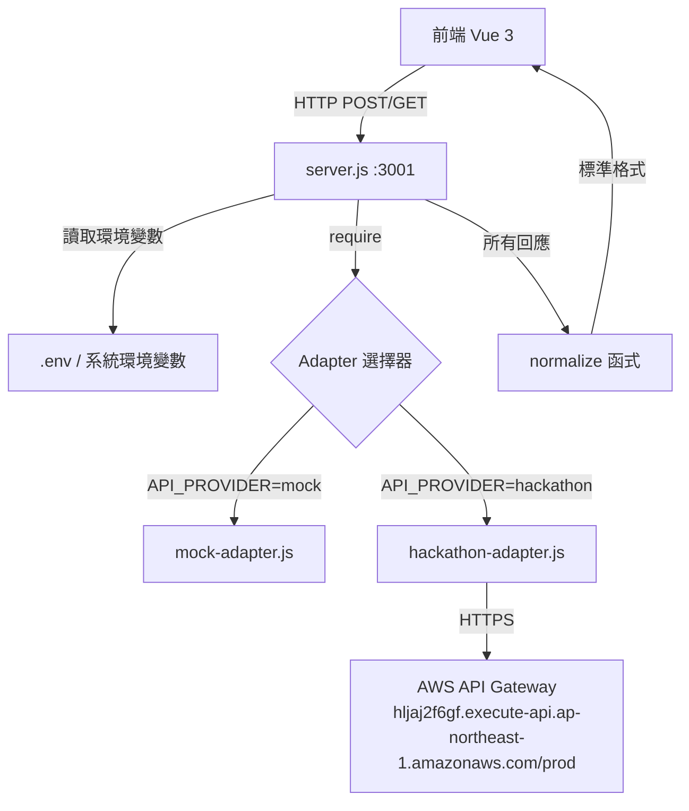
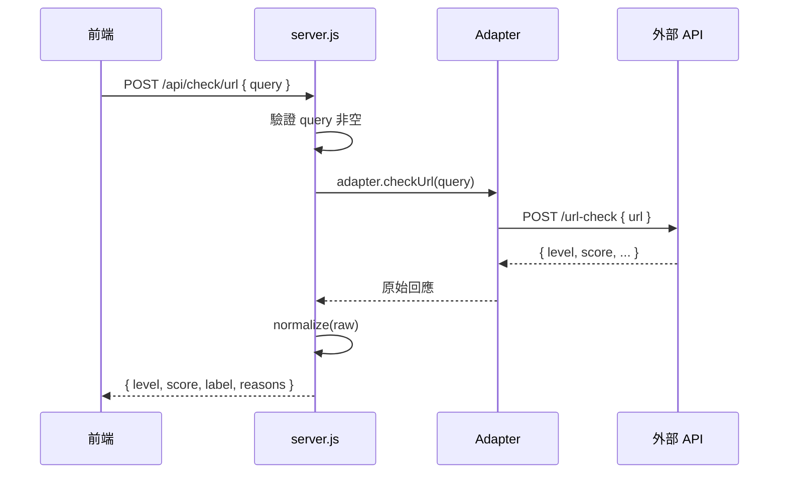
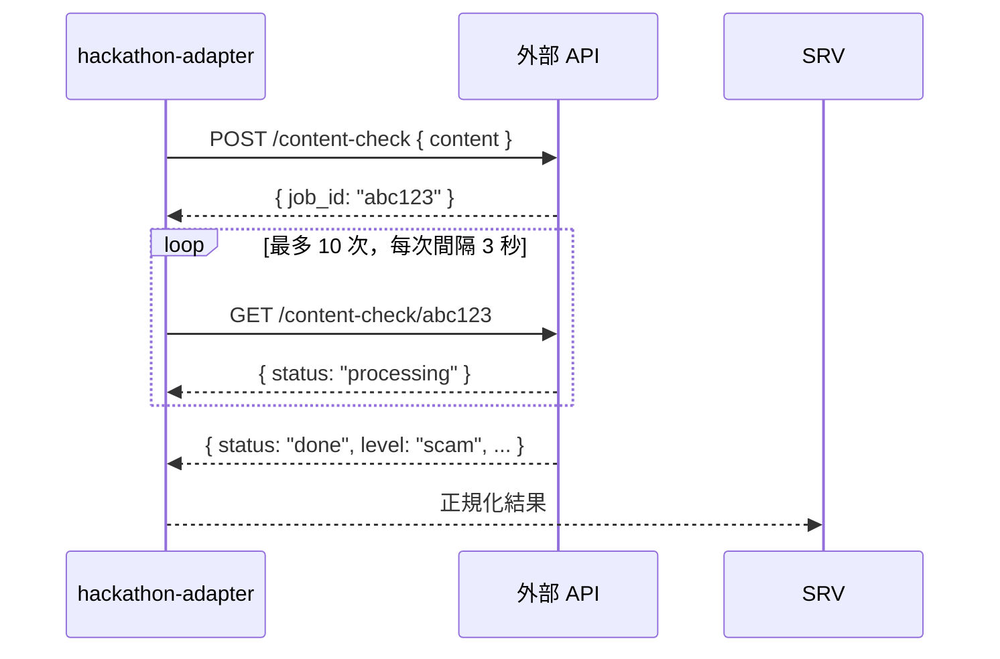

# 技術設計文件：後端 API 整合

## 概覽

「防詐雷達」後端以 Node.js 內建 `http` 模組運行於 port 3001，目前所有查詢結果皆為硬編碼的 mock 資料。
本設計描述如何在**不引入任何 npm 套件**的前提下，將後端升級為可對接真實外部 API 的架構，同時保留 mock fallback 機制。

### 設計目標

- 以 Adapter 模式隔離外部 API 細節，讓 server.js 不需感知底層實作
- 透過環境變數切換 Provider，零程式碼修改即可在 mock 與真實 API 之間切換
- 集中的 Normalizer 確保所有 Adapter 回傳格式一致
- Rate Limit 感知：hackathon API 有嚴格的 RPS/RPM 限制，需在 Adapter 層處理

### 技術限制

- 僅使用 Node.js 內建模組：`http`、`https`、`fs`、`path`、`crypto`
- 無 Express、無任何 npm 套件
- 非同步截圖查詢需在 Adapter 內部輪詢，對外仍呈現同步介面

---

## 架構

### 整體架構圖



### 請求流程



### 截圖非同步輪詢流程



---

## 元件與介面

### Adapter 介面規範

每個 Adapter 必須匯出以下四個非同步函式與一個 `name` 字串屬性：

```javascript
module.exports = {
  name: 'adapter-name',          // 識別用字串
  checkUrl(query: string): Promise<RawResult>,
  checkPhone(query: string): Promise<RawResult>,
  checkScreenshot(query: string): Promise<RawResult>,
  report(query: string): Promise<ReportResult>,
}
```

### server.js 核心元件

| 元件 | 職責 |
|------|------|
| `.env` 載入器 | 啟動時讀取 `.env` 並注入 `process.env` |
| Adapter 選擇器 | 依 `API_PROVIDER` 動態 `require` 對應 Adapter |
| `normalize(raw)` | 將任意原始回應轉換為標準格式 |
| `withFallback(fn)` | 執行 Adapter 函式，失敗時自動切換 mock |
| `readBody(req)` | 解析 POST JSON body |
| HTTP 路由 | 依 method + url 分派至對應處理邏輯 |

### hackathon-adapter.js 元件

| 元件 | 職責 |
|------|------|
| `request(method, path, body)` | 通用 HTTPS 請求函式 |
| `normalize(raw)` | Adapter 內部欄位對應（補充 server 層 normalize） |
| `checkUrl(query)` | 呼叫 `POST /url-check` |
| `checkPhone(query)` | 解析國碼後呼叫 `GET /number-check/{country}/{number}` |
| `checkScreenshot(query)` | 提交任務後輪詢 `GET /content-check/{job_id}` |
| `report(query)` | 產生本地案件編號（API 未提供此端點） |

### 外部 API 端點對應

| 本地端點 | 外部 API 端點 | 方法 | Rate Limit |
|----------|--------------|------|-----------|
| `POST /api/check/url` | `POST /url-check` | POST | 1 RPS |
| `POST /api/check/phone` | `GET /number-check/{country}/{number}` | GET | 1 RPS |
| `POST /api/check/screenshot` | `POST /content-check` + `GET /content-check/{job_id}` | POST+GET | 20 RPM |
| `POST /api/report` | （無對應，本地產生案件編號） | — | — |

---

## 資料模型

### RawResult（Adapter 回傳的原始格式）

```typescript
interface RawResult {
  level?:   'safe' | 'promo' | 'warn' | 'scam' | string
  score?:   number        // 0–100
  label?:   string
  reasons?: string | string[]
  // hackathon API 可能使用的別名欄位
  risk_level?:  string
  riskLevel?:   string
  risk_score?:  number
  riskScore?:   number
  summary?:     string
  description?: string
  details?:     string[]
  tags?:        string[]
}
```

### NormalizedResult（Normalizer 輸出，前端期望格式）

```typescript
interface NormalizedResult {
  level:   'safe' | 'promo' | 'warn' | 'scam'  // 預設 'warn'
  score:   number                                // 預設 50
  label:   string                                // 預設 '查詢完成'
  reasons: string[]                              // 預設 []
}
```

### ReportResult（回報端點回應）

```typescript
interface ReportResult {
  ok:     boolean
  caseNo: string | null
}
```

### 環境變數

| 變數名稱 | 型別 | 預設值 | 說明 |
|---------|------|--------|------|
| `API_PROVIDER` | string | `'mock'` | 指定使用的 Adapter（`mock` 或 `hackathon`） |
| `API_BASE_URL` | string | hackathon 預設 URL | 外部 API 的 Base URL |
| `API_KEY` | string | `''` | 外部 API 的認證金鑰（`x-api-key` header） |

### Normalizer 轉換規則

```
normalize(raw) → NormalizedResult

level:
  - 若 raw.level 屬於 { safe, promo, warn, scam } → 使用 raw.level
  - 否則 → 'warn'

score:
  - 若 raw.score != null → 使用 raw.score
  - 否則 → 50

label:
  - 若 raw.label 存在 → 使用 raw.label
  - 否則 → '查詢完成'

reasons:
  - 若 raw.reasons 為陣列 → 使用 raw.reasons
  - 若 raw.reasons 為字串 → [raw.reasons]
  - 否則 → []
```

---

## 正確性屬性

*屬性（Property）是在系統所有合法執行中都應成立的特性或行為，本質上是對系統應做什麼的形式化陳述。屬性是人類可讀規格與機器可驗證正確性保證之間的橋樑。*

### 屬性 1：Adapter 介面完整性

*對任意* Adapter 模組（包含 mock 與真實 Adapter），其匯出物件應包含 `checkUrl`、`checkPhone`、`checkScreenshot`、`report` 四個函式，以及 `name` 字串屬性。

**驗證需求：1.4、8.1、8.4**

---

### 屬性 2：Adapter 回傳格式符合規範

*對任意* Adapter 的任意查詢函式（`checkUrl`、`checkPhone`、`checkScreenshot`），以任意字串作為輸入呼叫後，回傳的 Promise 解析值應包含 `level`、`score`、`label`、`reasons` 四個欄位，且 `level` 屬於 `{ safe, promo, warn, scam }`，`reasons` 為陣列。

**驗證需求：1.5、3.2、4.2、5.2**

---

### 屬性 3：查詢端點回應格式

*對任意* 非空查詢字串，向 `/api/check/url`、`/api/check/phone`、`/api/check/screenshot` 發送請求後，回應應包含合法的 `{ level, score, label, reasons }` 結構，且 `level` 屬於 `{ safe, promo, warn, scam }`。

**驗證需求：3.1、3.5、5.1**

---

### 屬性 4：電話號碼清理

*對任意* 包含空白字元或連字號的電話號碼字串，server 在呼叫 `checkPhone` 前應移除所有空白與連字號，使傳入 Adapter 的字串不含這些字元。

**驗證需求：4.1**

---

### 屬性 5：Adapter 失敗時 Fallback 至 Mock

*對任意* 會拋出例外的 Adapter 函式，`withFallback` 包裝後的呼叫應回傳合法的 `NormalizedResult`（來自 mock adapter），而非拋出例外，且 `level` 屬於 `{ safe, promo, warn, scam }`。

**驗證需求：3.4、4.4、5.3**

---

### 屬性 6：回報端點回應格式

*對任意* 非空查詢字串，向 `/api/report` 發送請求且 Adapter 成功時，回應應為 `{ ok: true, caseNo: <非空字串> }` 格式；Adapter 失敗時應為 `{ ok: false, caseNo: null }`。

**驗證需求：6.2、6.3**

---

### 屬性 7：Normalizer 輸出格式

*對任意* 物件（包含空物件、欄位缺失的物件、欄位型別錯誤的物件），`normalize` 函式應回傳包含 `level`、`score`、`label`、`reasons` 四個欄位的物件，且 `level` 屬於 `{ safe, promo, warn, scam }`，`score` 為數字，`reasons` 為陣列。

**驗證需求：9.1、9.2、9.3、9.4、9.5**

---

### 屬性 8：Normalizer 冪等性

*對任意* 物件 `x`，`normalize(normalize(x))` 應與 `normalize(x)` 產生完全相同的結果（深度相等）。

**驗證需求：9.6**

---

### 屬性 9：Mock checkUrl 關鍵字比對

*對任意* 包含 `'scam'`、`'詐騙'`、`'phish'` 關鍵字的字串，`mock.checkUrl` 應回傳 `level: 'scam'`；對任意不含任何風險關鍵字的字串，應回傳 `level: 'safe'`。

**驗證需求：8.2**

---

### 屬性 10：Mock report 產生唯一案件編號

*對任意* 查詢字串，`mock.report` 應回傳包含非空 `caseNo` 字串的物件；連續呼叫兩次，兩次回傳的 `caseNo` 應不同（唯一性）。

**驗證需求：8.3**

---

## 錯誤處理

### 錯誤分類與處理策略

| 錯誤情境 | 處理方式 | HTTP 狀態碼 | 回應格式 |
|---------|---------|------------|---------|
| `query` 欄位為空字串 | 立即拒絕 | 400 | `{ error: "query 不得為空" }` |
| POST body JSON 格式錯誤 | 立即拒絕 | 400 | `{ error: "JSON 格式錯誤" }` |
| Adapter 呼叫拋出例外（查詢端點） | fallback 至 mock，記錄錯誤 | 200 | mock 結果 |
| Adapter 呼叫拋出例外（回報端點） | 回傳失敗格式，記錄錯誤 | 200 | `{ ok: false, caseNo: null }` |
| 找不到指定 Adapter 檔案 | fallback 至 mock，啟動時警告 | — | — |
| `API_KEY` 未設定但非 mock 模式 | 繼續啟動，輸出警告 | — | — |
| 截圖查詢輪詢逾時（10 次 × 3 秒） | 拋出例外，由 `withFallback` 處理 | 200 | mock 結果 |
| 外部 API 回傳非 JSON 回應 | 拋出解析例外，由 `withFallback` 處理 | 200 | mock 結果 |

### withFallback 設計

```javascript
async function withFallback(fn) {
  try {
    return normalize(await fn())
  } catch (err) {
    console.error('❌ Adapter 呼叫失敗：', err.message)
    return normalize(await mock.checkUrl(''))  // 回傳 safe 等級的 mock 結果
  }
}
```

fallback 時呼叫 `mock.checkUrl('')` 回傳 `level: 'safe'`，這是有意為之的保守設計——當無法確認風險時，不應誤報高風險。

### Rate Limit 注意事項

hackathon API 的 Rate Limit（1 RPS / 20 RPM）由呼叫方自行控制。後端 Adapter 不實作主動限流，但當外部 API 回傳 429 時，`withFallback` 會捕捉例外並回傳 mock 結果。

---

## 測試策略

### 雙軌測試方法

本功能採用**單元測試**與**屬性測試**並行的策略，兩者互補：

- **單元測試**：驗證具體範例、邊界條件、錯誤情境
- **屬性測試**：以隨機輸入驗證通用屬性，確保系統在所有合法輸入下都正確運作

### 屬性測試設定

- 使用 [fast-check](https://github.com/dubzzz/fast-check)（JavaScript 屬性測試函式庫）
- 每個屬性測試最少執行 **100 次迭代**
- 每個測試必須以註解標記對應的設計屬性：
  ```javascript
  // Feature: backend-api-integration, Property 8: Normalizer 冪等性
  ```
- 每個正確性屬性由**單一**屬性測試實作

### 屬性測試清單

| 屬性 | 測試標籤 | 迭代次數 |
|------|---------|---------|
| 屬性 2：Adapter 回傳格式 | `Property 2: Adapter 回傳格式符合規範` | 100 |
| 屬性 4：電話號碼清理 | `Property 4: 電話號碼清理` | 200 |
| 屬性 5：Fallback 機制 | `Property 5: Adapter 失敗時 Fallback 至 Mock` | 100 |
| 屬性 7：Normalizer 輸出格式 | `Property 7: Normalizer 輸出格式` | 200 |
| 屬性 8：Normalizer 冪等性 | `Property 8: Normalizer 冪等性` | 200 |
| 屬性 9：Mock 關鍵字比對 | `Property 9: Mock checkUrl 關鍵字比對` | 100 |
| 屬性 10：Mock report 唯一性 | `Property 10: Mock report 產生唯一案件編號` | 100 |

### 單元測試清單

| 測試目標 | 測試類型 | 對應需求 |
|---------|---------|---------|
| `normalize({})` 回傳預設值 | 邊界條件 | 9.2、9.3、9.4 |
| `normalize({ level: 'invalid' })` 回傳 `warn` | 邊界條件 | 9.5 |
| `POST /api/check/url` 空 query 回傳 400 | 邊界條件 | 3.3 |
| `POST /api/check/phone` 空 query 回傳 400 | 邊界條件 | 4.3 |
| `POST /api/report` 空 query 回傳 400 | 邊界條件 | 6.4 |
| `GET /api/health` mock 模式回傳 `mock: true` | 範例 | 7.2 |
| `GET /api/health` hackathon 模式回傳 `mock: false` | 範例 | 7.3 |
| `.env.example` 存在且包含所有必要變數 | 範例 | 2.4 |
| `API_KEY` 未設定時啟動輸出警告 | 邊界條件 | 2.5 |
| `.env` 不存在時使用 mock | 邊界條件 | 2.3 |
| 回報失敗時回傳 `{ ok: false, caseNo: null }` | 邊界條件 | 6.3 |

### 測試檔案結構

```
Backend/
└── test/
    ├── normalize.test.js      # 屬性 7、8（Normalizer 相關）
    ├── mock-adapter.test.js   # 屬性 1、2、9、10（Mock Adapter）
    ├── server.test.js         # 屬性 3、4、5、6（Server 端點）
    └── helpers.js             # 隨機資料生成器
```

### 執行方式

```bash
# 從 Backend 目錄執行（Node.js 內建測試執行器，Node 18+）
node --test test/normalize.test.js
node --test test/mock-adapter.test.js
node --test test/server.test.js
```
